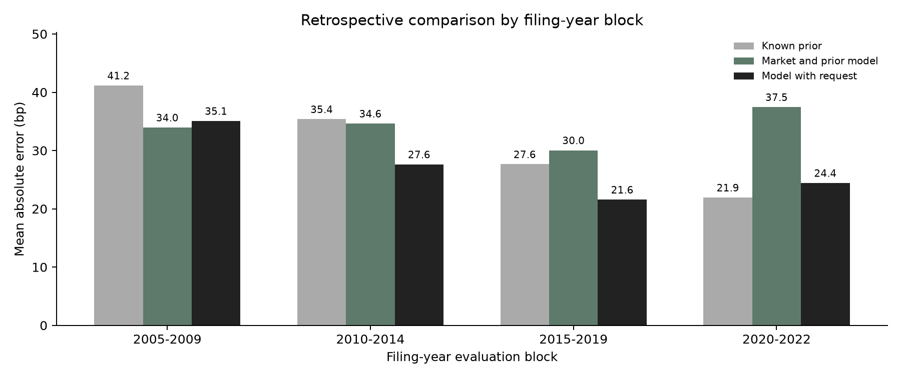

# Anchored Returns

**Interest rates, prior awards and authorized equity returns for US electric utilities**

Kazi Rafsan Mahboob | Dartmouth College | Independent research

[Paper PDF](paper/output/Mahboob_Utility_Returns_Working_Paper.pdf) · [Read online](paper/manuscript.md) · [Results](reports/README.md) · [Reproduce](docs/REPRODUCIBILITY.md)

## The question

I became interested in utility regulation while reading about data-center construction and the investment needed to expand the electricity grid. I expected financing conditions to be the main guide to the returns regulators allow. This project asks how much we learn instead from a utility's previous award, its requested return and recent decisions in other states.

## What I found

The previous award is a strong starting point. Across **568 later cases**, simply carrying it forward gives an average prediction error of **31.82 basis points**. A model combining market conditions and the prior has an error of **33.58**. Adding the utility's request reduces that error to **26.79**, an improvement of about **16% over the prior-only rule**.

The most recent filing group gives a different result. For **2020-2022 filings**, the prior-only rule performs best: **21.93 basis points**, compared with **37.45** for market conditions and the prior, and **24.43** after adding the request. Historical financial relationships provide useful context, but the earlier award is especially informative in this group.



Continuity also appears before the decision. With the same observations and controls, a one-percentage-point higher prior award is associated with a **22.24-basis-point higher request** and a **17.13-basis-point higher final award**. Recent other-state awards share much of the information in the utility's own prior and add little to forecasting accuracy.

Reading the original decisions helps explain what the percentages represent. A 100-basis-point performance reduction accounts for most of the model's large error for Central Maine Power. The [15-proceeding comparison pilot](reports/comparability/README.md) also shows how approved equity shares change the dollar allowance, even when two utilities receive the same ROE.

## Read the research

| Start here | What it contains |
|---|---|
| [Working paper](paper/manuscript.md) | The question, economic reasoning, figures and conclusions |
| [National results](reports/filing-study/README.md) | Requests, awards and prediction errors |
| [Peer comparison](reports/peer-study/README.md) | Other-state benchmarks and their additional information |
| [Original-order comparisons](reports/comparability/README.md) | Performance adjustments, capital structure and financial stakes |
| [Methods and code map](docs/ARCHITECTURE.md) | How the inputs, models and outputs fit together |

## Data and tools

The national study uses **1,785 request-and-award pairs from 1980-2024 across 50 jurisdictions**, drawn from EEI's rate-review workbook. Preserved Federal Reserve and BLS histories provide Treasury yields, inflation and state unemployment. Original commission decisions supply the case evidence.

Python prepares the data and estimates the models. R scripts check selected estimates and financial calculations. The local explorer filters cases and exports selections after the source-dependent tables are rebuilt. The original-order financial comparison can be reproduced directly from the included fact records.

```sh
python3 -m venv .venv
. .venv/bin/activate
python -m pip install -e '.[test]'
python -m scripts.check_public_release
python -m scripts.analyze_comparability
```

The [reproduction guide](docs/REPRODUCIBILITY.md) covers source acquisition, the national rebuild, R checks and the case explorer. EEI's workbook and case extracts are obtained separately under the provider's terms; the repository includes source information, aggregate results and the [data-rights record](docs/DATA_RIGHTS.md).

```text
paper/          Current manuscript, PDF and editable Word document
reports/        Supporting tables, figures and source-linked comparisons
src/            Data preparation, models and evidence tools
analysis/       R checks and Stata specifications
scripts/        Import, reproduction and validation commands
data/           Economic histories, source metadata and document facts
tests/          Calculation, timing and application checks
docs/           Methods, field definitions and research history
```

Earlier analyses and optional publication components are indexed in the [project guide](docs/ARCHITECTURE.md). Their existing paths remain available for reproduction.

## Interpretation

The estimates describe historical associations and retrospective prediction. Revised economic histories and incomplete request-amendment dates affect comparisons with information available in real time. The paper explains these issues, model uncertainty and the scope of the original-order sample in its concluding limitations section. R checks have been run; Stata specifications are supplied for replication. Independent human passage agreement remains a separate unfinished task.

## Research assistance

I used OpenAI's Codex for substantial help with research-design suggestions, source processing, programming, numerical checks and drafting. My interest in grid investment and initial expectation about market conditions motivated the question. The [paper](paper/manuscript.md#research-materials-and-assistance) records that assistance; the repository preserves the sources, analytical choices and coding provenance.
