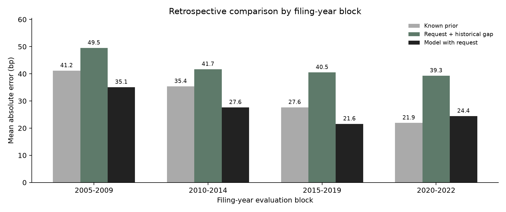

# Anchored Returns

**Requests, decisions and persistence in authorized utility returns**

Kazi Rafsan Mahboob · Dartmouth College · 2026

[Findings](reports/filing-study/README.md) · [Methods](docs/filing_study.md) · [Analysis plan](docs/filing_analysis_plan_2026-10-30.md) · [Reproduce](docs/REPRODUCIBILITY.md)

[](https://github.com/kazirafsanmahboob29-create/anchored-returns/actions/workflows/checks.yml)

## The question

A utility's earlier allowed return predicts its next award. I wanted to know how much of that persistence is already present in the utility's request, and whether the request helps predict the final decision.

I compare **1,785 recorded request-and-award pairs from 1980 to 2024**. The stage regressions use **1,266 observations from 1985 to 2024**, with **1,135** in the common sample requiring a prior award known before filing. I then evaluate six prediction rules on **568 later cases**. The source is EEI's public rate-review workbook, joined to preserved Treasury, inflation and state-unemployment histories.

These are publisher-table observations. They are separate from the project's 27 original commission orders and passage-coding records. An authorized return is an allowed earnings opportunity, rather than a realized investor return. **One percentage point equals 100 basis points.**

## What I found

**Persistence appears in the request as well as the final award.** With the same observations and state/year controls, a one-percentage-point higher known prior award is associated with a **22.24-basis-point** higher request and a **17.13-basis-point** higher final award. Their difference is imprecise. The results do not establish that commissions systematically offset the association already present in requests.

**The request adds predictive information to the combined model.** Across 568 comparisons, adding it to a market/prior model lowers average absolute error from **33.58 to 26.79 basis points**. Simply carrying forward the known prior gives **31.82**. The combined model's 5.03-basis-point improvement over the prior has an approximate conditional 95% interval of **0.62 to 9.45**.

**The gain depends on the period.** The combined model improves on the prior in three available evaluation blocks and loses in 2020–2022: **24.43 versus 21.93 basis points**. All blocks, baselines and uncertainty checks are reported. The results are retrospective comparisons using recorded requests and revised histories, rather than live-issued forecasts.



The [case study](reports/filing-study/README.md) explains the results and their limits. The [historical expansion](reports/expanded-study/README.md) separately examines 759 complete observations, a 1,141-observation longer-window specification and 717 award changes. Earlier releases remain unchanged.

## Explore the records

The new case explorer filters real pairs by period, region, utility, state and docket. It updates paired means, request-award gaps and annual figures, and downloads the selected source rows. It uses a cream background, black text and restrained charts. Filters describe the selected cases without changing the published regressions.

```sh
python3 -m venv .venv
. .venv/bin/activate
python -m pip install -e '.[test]'
python -m src.research serve --snapshot
```

Open **http://127.0.0.1:8765/presentation/filing.html**. Python 3.11 or later is required. The included records run without API keys or original PDFs. On Windows, activate with `.venv\Scripts\activate`.

## Reproduce the research

```sh
python -m src.filing_study --check

# Rebuild the stage models and compare them independently in R.
python -m src.filing_study
Rscript analysis/filing.R reports/filing-study
python -m src.filing_study --verify-r

# Run the Python and browser calculation checks.
python -m scripts.check_calculations
python -m scripts.check_links
```

`make filing` runs the build and R comparison. Node.js 24 is needed for browser tests. Stata syntax and Unicode DTA datasets are included, with numeric round-trip checks; native Stata execution remains unverified.

The NumPy models support fixed effects, weighted estimation and state/quarter cluster covariance. Tests compare them with statsmodels. Native R reconstructs all 12 stage models, three covariance choices, 35 coefficient identities and six prediction rules. The build checks that every award coefficient equals the request coefficient plus the award-minus-request coefficient. It also preserves strict prior-decision dates and training cutoffs.

## Data and design

| Component | Coverage and purpose |
|---|---|
| Request-and-award pairs | 1,785 pairs in 1980–2024; 50 jurisdictions |
| Stage regressions | 1,266 complete pairs in 1985–2024 |
| Known-prior decomposition | 1,135 observations, with strictly earlier filing-stage awards |
| Retrospective prediction | 568 unique cases; four available filing-year blocks; six rules |
| Historical models | Preserved 759- and 1,141-observation specifications |
| Economic inputs | 53 preserved series plus an Alabama history for the earlier descriptive cases |
| Original-document work | 27 orders; 68 verified numeric facts; independent agreement unmeasured |

The EEI workbook was checked against its public source again on October 30. Financial and labor-market inputs retain source URLs, reference dates and fingerprints. Missing requests and awards remain missing. The [methods](docs/filing_study.md) explain sample selection, revised inputs, request-vintage uncertainty and why regression associations are not causal mechanisms. The [dated plan](docs/filing_analysis_plan_2026-10-30.md) also identifies diagnostic changes made after the first calculation.

The known prior is selected **before filing**, rather than before authorization. This changes the prior identity for 105 paired cases, including unavailable filing priors. Equal state/decision-day weighting and 49 state omissions check sensitivity to the composition of the case table. No fuzzy company matching is used.

## Project structure

```text
anchored-returns/
├── src/
│   ├── filing_study.py       Requests, decisions, weighted models and prediction
│   ├── economic_history.py   Indexed, dated economic joins
│   ├── panel_models.py       NumPy OLS and clustered covariance
│   ├── expanded_study.py     Historical models and regional comparisons
│   └── research_*.py         Original-order evidence and coding tools
├── analysis/                 Independent R and prepared Stata replication
├── data/external/            Preserved workbook, histories and source metadata
├── data/research/            Original orders, numeric facts and coding records
├── reports/filing-study/     Current case study, source rows, estimates and figures
├── reports/expanded-study/   Preserved historical expansion
├── presentation/filing/      Case explorer calculations, view and styles
├── tests/                    Statistical, timing, source and application checks
├── docs/                     Methods, definitions and dated decisions
└── scripts/                  Retrieval, builds and validation
```

Start with [filing_study.py](src/filing_study.py), [filing.R](analysis/filing.R) and the [results index](reports/README.md). The [architecture guide](docs/ARCHITECTURE.md) describes the other components. GitHub Actions runs Python, JavaScript and native R on complete pull requests and main updates.

## Earlier publications

The [Dartmouth article](https://kazirafsanmahboob.host.dartmouth.edu/research/anchored-returns/) and [original workbench](https://kazirafsanmahboob.host.dartmouth.edu/tools/anchored-returns/) still present the original 2010–2024 study. The current request-and-decision study and explorer are in this repository. Updating GitHub does not update WordPress.

The [reproduction guide](docs/REPRODUCIBILITY.md) covers original PDF restoration and complete document validation. Independent passage ratings and five strict historical benchmark periods remain unresolved. Neither enters the numerical results above. Source rights, coding provenance and historical outputs remain available for inspection.
