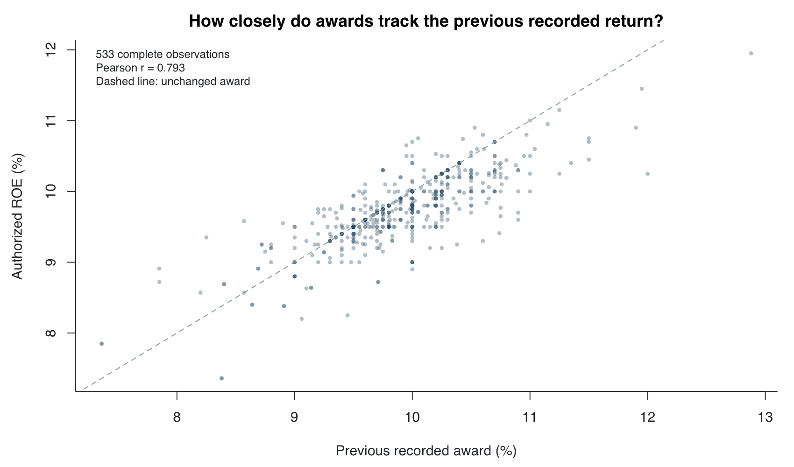
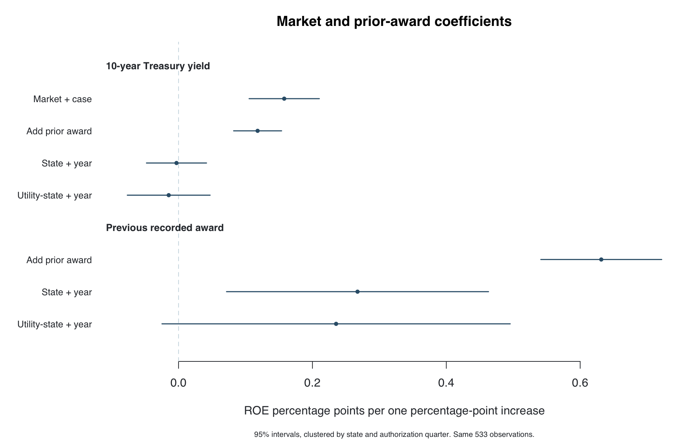

# Anchored Returns

Market Conditions and Persistence in Authorized Utility Returns

Kazi Rafsan Mahboob · Dartmouth College · 2026

[](https://github.com/kazirafsanmahboob29-create/anchored-returns/actions/workflows/checks.yml)

State commissions set the return on equity a regulated utility can earn through its rates. I built this project to examine how those awards relate to financial conditions and how much information is already contained in a utility's previous award.

[Research article](https://kazirafsanmahboob.host.dartmouth.edu/research/anchored-returns/) · [Interactive workbench](https://kazirafsanmahboob.host.dartmouth.edu/tools/anchored-returns/) · [Documentation](docs/README.md) · [Portfolio](https://kazirafsanmahboob.host.dartmouth.edu/)

## Main results

The estimation panel contains **533 complete observations from 2010 to 2024**, covering 47 jurisdictions and 131 utility-state groups.

- Current and previous awards have a Pearson correlation of **0.793**.
- The positive pooled relationship between Treasury yields and authorized returns becomes close to zero after state and year controls. The previous-award coefficient remains positive, although it is less precise with utility-state effects.
- In a later-case prediction check, adding the previous award reduces mean absolute error from **53.1 to 23.3 basis points**. Simply using the previous award gives **24.2 basis points**. The estimated model therefore improves on that simple rule by only **0.9 basis points**.

The evidence points to strong persistence in recorded awards. It does not identify whether that persistence comes from deliberate reliance on precedent, stable utility characteristics, commission policy or other omitted factors. The historical economic series include later revisions, so the prediction exercise is retrospective.





| Prediction rule | Test-period MAE, basis points |
|---|---:|
| Training-period mean | 42.2 |
| Previous award | 24.2 |
| Market and case variables | 53.1 |
| Model including previous award | 23.3 |

Models are fitted on 345 observations from 2010 to 2019 and evaluated on 188 observations from 2020 to 2024. See the [methods](docs/factor_study.md) for the sample rules, covariates, uncertainty estimates and robustness checks.

## What the software does

- Builds dated financial variables and links them to utility rate-case records.
- Estimates correlations and panel regressions, including state, year and utility-state controls.
- Evaluates predictions against a previous-award baseline on later cases.
- Lets a reader change model specifications, periods, regions and weighting in the browser.
- Exports calculation records and retains the source row, document page and file fingerprint behind an entry.
- Refreshes Treasury and CPI inputs through public Treasury and BLS endpoints. Published paper results continue to use the preserved input vintage.
- Provides separate tools for original-order review, numeric evidence and blinded passage ratings.

## Run locally

Python 3.11 or later and Node.js 24 are the supported setup. R is optional for the Python/browser tools and required for the native cross-check. Stata scripts require a licensed Stata installation.

```sh
python3 -m venv .venv
. .venv/bin/activate
python -m pip install -e '.[test]'
python -m src.research serve --snapshot --port 8765
```

Open **http://127.0.0.1:8765/presentation/index.html**. The included tables and compiled application work without downloading the original order PDFs. PDF viewing and full document validation require source restoration.

On Windows, activate with `.venv\Scripts\activate` and use the same `python -m ...` commands.

## Reproduce and test

```sh
python -m src.research national
python -m src.research factors
Rscript analysis/factors.R reports/factor-study
python -m scripts.check_calculations
```

The last command runs the source-independent Python and JavaScript checks used in continuous integration. It does not claim to validate absent original PDFs or execute Stata. The [reproduction guide](docs/REPRODUCIBILITY.md) covers source restoration, complete evidence checks and each statistical environment.

## Data and scope

| Component | Coverage | Role |
|---|---|---|
| EEI national table | 2,589 source rows; 2,230 completed base-rate observations after exclusions | National comparisons and the starting table for panel construction |
| Main estimation panel | 533 complete observations, 2010 to 2024 | Correlations, regressions and the later-case test |
| Regional numerical panel | 57 completed EEI observations; 46 reported awards | New England period comparisons |
| Original-document cohort | 27 orders; 68 verified numeric facts | Source review and close reading |
| Complete first-pass passage coding | Three orders; 67 units | Initial coding work, kept separate from the numerical models |

The document cohort is not a random sample of all decisions. Independent coding agreement is unmeasured, and some historical RRA benchmark periods remain unavailable. Those gaps are reported in the research records; no ratings or benchmark values are imputed to fill them. Test fixtures use synthetic values only to check software behavior.

Source files, acquisition dates and SHA-256 hashes are documented in the [source guide](docs/data_sources.md) and [data dictionary](docs/DATA_DICTIONARY.md). Original order PDFs are restored separately because they are large and retain their publishers' rights.

## Repository map

| Path | Contents |
|---|---|
| [src/](src/) | Python data processing, models, source validation and command-line tools |
| [analysis/](analysis/README.md) | R and Stata replication scripts |
| [data/](data/) | Dated input tables, metadata, exact excerpts and coding records |
| [reports/](reports/README.md) | Preserved results, figures and cross-checks |
| [presentation/](presentation/) | Local research interface and browser calculations |
| [tests/](tests/) | Numerical, evidence, connector and import/export checks |
| [docs/](docs/README.md) | Methods, definitions, source rights and usage notes |
| [wordpress/](wordpress/), [web/](web/README.md) | Portable browser bundle and optional server adapters |

The WordPress portfolio theme is maintained outside this repository. `portfolio/` contains earlier publication fragments, and `web/research-release/` is a preserved service export. Neither is the starting point for a new analysis. See the [architecture guide](docs/ARCHITECTURE.md) for the active components.

## Research record

[Analysis specification](docs/factor_analysis_plan_v0.1.0.md) · [Robustness and results](docs/factor_study.md) · [National study](docs/national_study.md) · [Source rights](docs/DATA_RIGHTS.md) · [Contribution notes](CONTRIBUTING.md)

The repository preserves original coding provenance and dated releases. A first coding pass is not independent agreement evidence. Native R estimates were checked against Python; native Stata execution remains unverified.

For attribution, use [CITATION.cff](CITATION.cff) and identify the input vintage and cohort version. Third-party documents and libraries retain their original notices. No blanket license is granted over the complete research archive.
