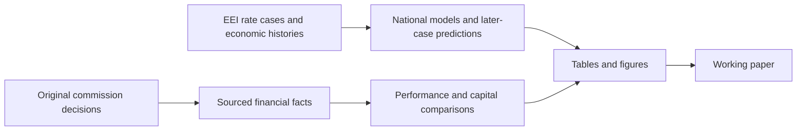

# How the project fits together

Anchored Returns has two connected parts. The national analysis compares requests, awards and financing conditions across time. The original-order study examines the decisions behind selected percentages and calculates their financial implications.

## Research workflow

The [paper](../paper/manuscript.md) is the main narrative. The [results index](../reports/README.md) identifies the current outputs, and the [reproduction guide](REPRODUCIBILITY.md) supplies the commands.

## Current analysis code

| Entry point | Responsibility | Outputs |
|---|---|---|
| [scripts/reproduce_filing.py](../scripts/reproduce_filing.py) | Rebuild source-dependent analyses in dependency order | National and historical inputs, filing and peer results |
| [src/filing_study.py](../src/filing_study.py) | Request and award models, known priors and later-case predictions | `reports/filing-study/` |
| [src/peer_study.py](../src/peer_study.py) | Other-state award windows and their additional information | `reports/peer-study/` |
| [scripts/compare_treasury_models.py](../scripts/compare_treasury_models.py) | Compare periods and timing designs on matched samples | `reports/treasury-comparison/` |
| [src/rate_case_comparisons.py](../src/rate_case_comparisons.py) | Resolve original-order facts and calculate equity allowances | Used by the pilot build |
| [scripts/analyze_comparability.py](../scripts/analyze_comparability.py) | Build the financial pilot tables and figures | `reports/comparability/` |
| [paper/build.py](../paper/build.py) | Typeset the maintained manuscript | `paper/output/` |

`economic_history.py` handles dated economic joins. `panel_models.py` implements estimation and uncertainty calculations. R scripts in [analysis](../analysis/README.md) check selected models and financial calculations from the same prepared inputs. Stata specifications provide an additional replication route.

## Data organization

| Location | Contents |
|---|---|
| `data/external/` | Economic histories and provider metadata; acquired EEI inputs are local |
| `data/research/comparability-v1/` | Fixed pilot selection and source-linked Phase 2 facts |
| `data/research/` | Earlier cohort, source and passage-coding records |
| `reports/` | Aggregate estimates, figures and results metadata |

Each original-order fact retains its proceeding, value role, units and source location. Related utility schedules remain linked to their shared proceeding. The main models require strictly earlier awards for the filing-stage prior. The [field dictionary](comparability_fields.md) and [filing methods](filing_study.md) explain these choices.

## Explorer and earlier components

The current case explorer is [presentation/filing.html](../presentation/filing.html). After the national rebuild, its filters summarize local cases and export selections. Its modules are in `presentation/filing/`.

Earlier analyses remain in `src/factor_study.py`, `src/expanded_study.py`, `src/national_study.py` and `src/prediction_audit.py`. Their result folders are indexed under [research history](../reports/README.md#research-history). They supply earlier specifications and intermediate inputs used by the national reproduction command.

The original document tools in `src/research_*.py` support source extraction, evidence validation, cohort records and passage coding. `codebook/` retains the coding definitions. These records stay separate from independently collected ratings.

`web/`, `wordpress/` and `portfolio/` contain optional service and earlier publication components. They are retained at their existing paths because earlier commands and tests refer to them. The withdrawn `web/research-release/` bundle is excluded from the current source package. The WordPress portfolio theme is maintained separately.

## Checks

`python -m scripts.check_public_release` runs the public source and fixture checks. `python -m scripts.check_links` checks maintained documentation links. Source-dependent research checks follow local acquisition and reproduction. The pilot's financial calculations also have a small native R check, `analysis/comparability_check.R`.
