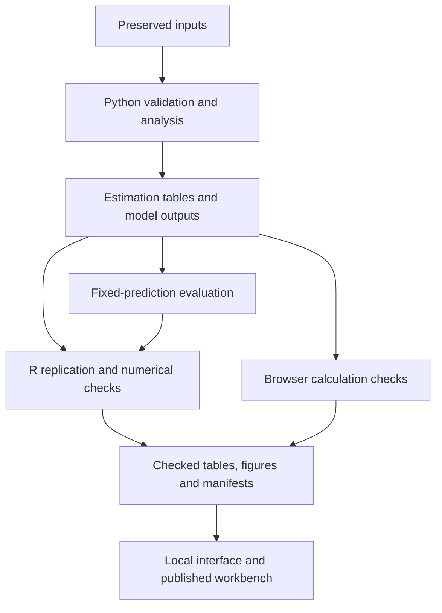

# Project structure

The current request-and-decision extension is implemented in `src/filing_study.py`. It reuses the economic date indexes and cluster-covariance module, then exports source rows, stage identities, weighted estimates and filing-year prediction blocks into `reports/filing-study/`. Independent R reconstruction reads those source rows and model definitions. `presentation/filing.html` and `presentation/filing/` provide a separate case explorer; descriptive filters do not alter the published model estimates. The snapshot server explicitly allows those public assets and reports. See the [methods](filing_study.md).

The national numerical study and original-order study share source-handling tools but answer different questions. The national panel measures associations and prediction errors. The document tools retain the passages and numeric evidence needed to study commissions' stated reasoning.

## Data flow

Preserved inputs include the EEI case table, dated economic histories and original-order records. Prepared Stata scripts provide a separate replication route; native execution remains unverified.

A live economic refresh creates a separate calculation with its own source dates. It does not replace the published input vintage or change the case table.

## Main numerical analysis

The current historical extension is separate from the frozen 2010–2024 study. `economic_history.py` owns source validation and indexed joins. `panel_models.py` owns least squares, covariance and contrasts. `panel_diagnostics.py` enumerates state omissions. `expanded_study.py` builds the samples, runs the specification table and provides the region/period explorer. These layers are tested separately. [Expanded methods](expanded_study.md) document their inputs and timing rules.

| Entry point | Responsibility |
|---|---|
| [src/expanded_study.py](../src/expanded_study.py) | Historical extension, rolling evaluation, exports and exploratory selections |
| [analysis/expanded.R](../analysis/expanded.R) | Independent reconstruction of extended models, diagnostics and predictions |
| [analysis/expanded.do](../analysis/expanded.do) | Built-in Stata replication using shared model specifications |
| [src/factor_study.py](../src/factor_study.py) | Panel construction, dated predictors, regressions, uncertainty and later-case evaluation |
| [src/prediction_audit.py](../src/prediction_audit.py) | Paired errors, uncertainty, annual stability and weighting checks for the saved predictions |
| [src/national_study.py](../src/national_study.py) | National period comparisons |
| [src/eei_benchmarks.py](../src/eei_benchmarks.py) | EEI normalization and half-year reconstruction |
| [analysis/factors.R](../analysis/factors.R) | Independent coefficient and covariance calculations; main figures |
| [analysis/prediction_audit.R](../analysis/prediction_audit.R) | Independent loss, covariance and prediction-figure calculations |
| [analysis/factors.do](../analysis/factors.do) | Prepared Stata implementation |
| [reports/factor-study](../reports/factor-study/) | Published numerical outputs and fingerprints |
| [reports/prediction-audit](../reports/prediction-audit/) | Separate evaluation tables, figures and fingerprints |

The [methods](factor_study.md) explain the estimation sample and specification choices. The [results index](../reports/README.md) identifies the saved tables.

## Original-order research

`research_ledger.py` validates exact source text and numeric roles. `research_sample.py` retains the original quota design. `research_cohort.py` checks the expanded cohort against the screening records. `cohort_facts.py` checks additional numeric entries without rewriting the frozen coding pass.

`research_overview.py` assembles the interface payload. `research_insights.py` calculates document-level comparisons. `research_analysis.py` exports CSV and Stata datasets and produces available Python/R figures. Each run writes a new dated directory; `reports/analysis/latest.json` points to the current release.

Source records retain their actual coder and verification identities. Those fields distinguish a first pass from independent ratings and are part of the research evidence.

## Browser and publication components

| Directory | Role |
|---|---|
| [presentation](../presentation/) | Local interface and numerical browser modules |
| [wordpress](../wordpress/) | Portable browser application for WordPress |
| [web](../web/README.md) | Optional Worker service, source delivery and stored market retrievals |
| [portfolio](../portfolio/) | Earlier publication fragments and builder inputs |

Browser calculations are separated from interface code where possible. For example, `presentation/workspace/analysis.mjs` implements selection, summaries, validation and CSV export without a DOM or network dependency. Imported selections are recalculated from known source rows; imported results are not accepted as authoritative.

The optional Worker service validates allowed source paths and fingerprints. It writes a complete market retrieval before advancing the latest pointer. A failed request leaves the previous complete retrieval available. Hosting credentials are configured separately and are not committed.

The frozen `web/research-release/` export is retained for reproducibility. It contains historical copies of documents and is not the maintained documentation directory. The current WordPress theme is maintained outside this repository. See the [publication guide](dartmouth_portfolio.md).

## Checks

- `python -m scripts.check_links` checks maintained documentation paths and anchors.
- `python -m scripts.check_calculations` runs the source-independent Python and JavaScript checks.
- `python -m src.prediction_audit --check` verifies and recomputes the saved prediction evaluation.
- R checks selected numerical estimates against Python using the same preserved inputs.
- Full document checks require restored original PDFs and review files.

These checks validate different parts of the project. Passing a software test does not supply an independent rating or establish a causal interpretation.
