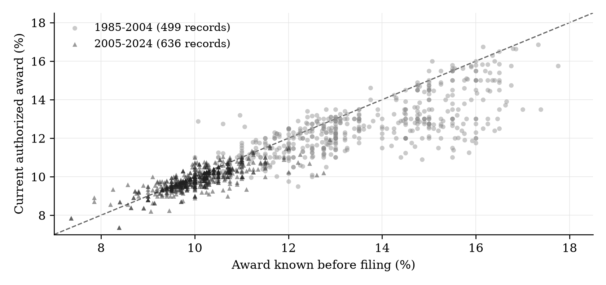
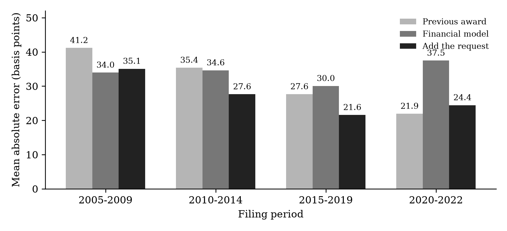

# Interest Rates and Authorized Equity Returns for US Electric Utilities

Evidence from rate cases between 1980 and 2024

Kazi Rafsan Mahboob

Dartmouth College | Independent research working paper | October 31, 2026

## Abstract

How much do financing conditions explain the returns regulators allow electric utilities to earn? I examine 1,785 request-and-award pairs and compare market indicators with the utility's previous award, its request and recent other-state awards. Allowed returns change much less than Treasury yields between successive utility decisions. Across 568 later cases, adding the request to a financial model reduces average prediction error from 33.58 to 26.79 basis points. The previous award alone nevertheless performs best for 2020-2022 filings. Other-state awards add little information beyond the utility's own history. Original decisions help explain the numerical results: a documented performance reduction accounts for most of one large prediction error, and approved capital structure changes the dollar value of an identical ROE. The findings show why both the history and the composition of an award matter when comparing regulatory outcomes.

## 1 The question

I became interested in utility regulation while reading about data-center construction and the investment needed to expand the electricity grid. I wanted to understand how utilities finance that investment and how regulators decide what investors should be allowed to earn. My initial expectation was that market conditions would be the main influence. Investors can put new money into other industries if a utility's expected return is unattractive, even though its existing power lines and substations remain in place.

That led to two questions. How closely do allowed returns move with interest rates? And how much additional information comes from the utility's previous award and its own proposal? I approached these questions as an undergraduate learning how to connect an economic argument to public records and a testable comparison.

Rode and Fischbeck (2019) document that allowed equity returns declined more slowly than Treasury yields over several decades. Dunkle Werner and Jarvis (2026) connect return-setting to investment decisions and consumer costs. I build on that motivation by comparing requests and decisions, evaluating predictions on later cases, and reading the original orders behind selected outcomes.

## 2 How an allowed return enters electricity rates

An investor-owned utility finances its assets with borrowing and shareholders' money. The shareholders' portion is equity. A regulator sets an authorized return on equity, or ROE, as part of the calculation of how much revenue the utility may collect through rates.

Suppose the regulator recognizes $100 of equity capital and allows a 10% return. The rate calculation includes $10 a year for that equity. Operating costs, debt financing, depreciation and taxes enter other parts of the calculation. The allowed ROE gives the utility an opportunity to earn the equity return; actual earnings also depend on costs and performance.

In a rate case, the utility proposes rates and an ROE. Staff, consumer advocates and other parties offer competing estimates. Some methods use stock prices and expected dividends; others combine a Treasury yield with compensation for risk. The commission evaluates the evidence and issues a decision or approves a settlement. Bluefield (1923) and Hope (1944) establish the familiar principles of comparable-risk returns and the ability to attract capital.

This gives interest rates a clear economic role. It also leaves room for differences in business risk, financing needs and rate-setting arrangements. The empirical task is to measure how these recorded outcomes move together. I report small differences in basis points: a change from 9.50% to 9.75% is 25 basis points, and 100 basis points equal one percentage point.

## 3 Data and comparisons

The case records come from EEI's 2025 Q3 Rate Review workbook. The eligible history contains 2,198 completed electric distribution and vertically integrated records through 2024. Distribution utilities deliver electricity locally; vertically integrated utilities also generate it. Transmission-specific proceedings and narrow adjustments outside general base rates are excluded. Of the eligible records, 1,785 report both requested and authorized returns with valid filing dates. Awards average about 98 basis points below requests.

Table 1 Samples used in the analysis

| Sample | What it is used for | Records |
|---|---|---:|
| Request and award pairs from 1980-2024 | Describe requests and decisions | 1,785 |
| Complete pairs from 1985-2024 | Estimate request and award relationships | 1,266 |
| Complete pairs with a known prior award | Compare both stages with the earlier award | 1,135 |
| Cases with a prior and a peer average | Examine other-state awards | 1,109 |
| Later cases in the prediction comparison | Evaluate rules fitted on earlier decisions | 568 |

Federal Reserve and BLS histories supply the ten-year Treasury yield, inflation and state unemployment. The main financial measures use dates before filing. The prior is the most recent award for the exact utility-state label that was decided before the new filing, within ten years. This timing rule matters: an award issued in June is unavailable to a filing made in January.

I use two kinds of comparison. Regressions describe how awards vary with several measured factors at once. State controls account for persistent jurisdictional differences, while decision-year controls compare cases within the same year. Separate successive-change models examine movements between decisions for the same utility. These designs address different parts of the original question.

The prediction exercise fits models on earlier decisions and tests them on later cases. Every model is compared with the simple rule of repeating the previous award. I report average absolute error, the average distance between predicted and actual awards. Uncertainty ranges allow observations in the same state or decision quarter to move together through two-way clustering. Appendix B gives the detailed timing rules.

## 4 What the national records show

### Awards change less than Treasury yields

Between consecutive decisions over 2010-2024, a one-percentage-point change in the Treasury yield is associated with an award change of about 10 basis points. Extending the period to 1995-2024 gives about 9 basis points. These comparisons show much smaller movements in allowed returns than in government borrowing yields. Appendix A reports both estimates and their uncertainty ranges.

The period also matters for the within-year regression. With state and year controls, the filing model gives a Treasury association of about 21 basis points over 1985-2024. Restricting that same model to 2010-2024 reduces the estimate to less than one basis point. On 529 cases shared with the earlier decision-date design, both designs give estimates close to zero. The matched comparison identifies the historical window as the main source of the apparently conflicting results (Appendix B).

### Continuity is visible in requests as well as awards

Figure 1 compares each current award with the award known before filing. The diagonal marks no change. The older and newer cases occupy different parts of the graph, reflecting the decline in the general level of allowed returns over the sample period.

Figure 1 Current awards and awards known before filing

Note: Each point is one record in the common sample. Groups refer to decision years.

With state and year controls, a one-percentage-point higher prior award is associated with a request about 22 basis points higher and a final award about 17 basis points higher. The association is already present when the utility states its position. A plausible explanation is that utilities form requests around both financing needs and their expectations of an acceptable outcome. The prediction exercise tests whether the proposal contains useful information beyond the earlier award and financial conditions.

### The request improves average prediction

The four evaluation groups use filing years 2005-2009, 2010-2014, 2015-2019 and 2020-2022. Each model is fitted on decisions completed before its group begins. The financial model uses filing-date conditions, case type, the known prior and its age. The second model adds the request.

Table 2 Average prediction error across 568 later cases

| Prediction rule | Average absolute error in basis points |
|---|---:|
| Carry forward the known prior award | 31.82 |
| Financial conditions and the prior award | 33.58 |
| Financial conditions, prior award and request | 26.79 |

Note: The request model improves on the prior-only rule by 5.03 basis points [95% interval 0.62, 9.45] and on the financial model by 6.79 [3.03, 10.55].

The request lowers the financial model's average error by about seven basis points. It also improves on the prior alone by about 16%. Its value comes from combining it with other information: using the request on its own gives an error of about 66 basis points.

Figure 2 Prediction errors across filing periods

Note: Lower bars indicate smaller errors. The groups contain 122, 169, 175 and 102 cases. Every rule uses the same evaluation cases within a group.

The 2020-2022 filing group is especially informative. Repeating the prior gives an error of 21.93 basis points, compared with 37.45 for the financial model and 24.43 with the request. In this group, the company-specific award history is more useful than the estimated historical financial relationship.

The group includes decisions made from 2020 through 2024. Among the 59 decisions on or after the Federal Reserve's March 16, 2022 announcement, the same ordering holds: errors are about 20 basis points for the prior, 37 for the financial model and 22 with the request. Continuity remains visible in those later decisions. The reasons behind that continuity are a question for the institutional evidence.

### Other-state awards share much of the prior information

For each filing, I calculate the average award in other states over the preceding twelve months. The window excludes the utility's own state and decisions on or after filing. Each state and decision date receives equal total weight; a window needs ten awards from five other states.

Table 3 Peer associations on the same 1,109 cases

| Time controls with state controls | Estimate in basis points | 95% uncertainty range |
|---|---:|---:|
| No common time control | 35.35 | 22.84 to 47.86 |
| A linear trend over time | 38.30 | 24.48 to 52.13 |
| Separate controls for each decision year | 15.41 | -5.74 to 36.56 |

Note: Estimates describe a one-percentage-point difference in the peer average, with the own prior and other measured controls included.

Peer awards have a positive historical association with the next award. The estimate becomes smaller and imprecise when year controls absorb common annual movements. The own prior and peer average correlate at about 0.92, so they contain much of the same historical information. Refitting on the same peer-available training records, adding peers lowers the financial model's error from about 33 to 32 basis points. The one-basis-point gain has an interval of -0.4 to 2.4. The utility's own history captures most of the predictive information in this comparison.

## 5 Reading the decisions behind the numbers

The model's third-largest error concerns Central Maine Power's 2020 award. It predicts 9.36%, compared with an applied award of 8.25%. The original order identifies a selected base return of 9.25% and a separate 100-basis-point reduction for management and customer-service failures (Maine PUC, 2020, pp. 118 and 137).

Table 4 Selected base and applied returns

| Utility and order year | Before reduction | Reduction in basis points | After reduction |
|---|---:|---:|---:|
| Central Maine Power 2020 | 9.25% | 100 | 8.25% |
| United Illuminating 2023 | 9.10% | 47 | 8.63% |

The Maine prediction is about 11 basis points from the selected base return. The performance reduction accounts for most of the roughly 111-basis-point prediction error. Connecticut's United Illuminating decision provides a second example of the same distinction between the base and applied return (PURA, 2023, pp. 59 and 91).

A defined 15-proceeding pilot in six states extends this source review. Original dispositions have been obtained for every selected proceeding, with adopted ROE and equity-share inputs entered for twelve. The three Pennsylvania proceedings approve negotiated revenue packages without individually adopting those return components. The source ledger retains those settlements alongside the numerical schedules.

Capital structure adds another useful comparison. In a joint 2017 Massachusetts decision, NSTAR and Western Massachusetts Electric both received 10.00% ROEs. Their approved equity shares were 53.34% and 54.51%. Per $100 of rate base, the annual equity components were therefore $5.334 and $5.451. The identical headline ROE produced a 2.2% larger equity component for WMECo (Massachusetts DPU, 2017, pp. 770 and 779).

The dollar stakes depend on the approved investment base as well. Massachusetts Electric and Nantucket Electric's combined 2024 schedule has a $3.127 billion distribution rate base and a 52.83% equity share. A 25-basis-point ROE difference, holding those inputs fixed, changes the annual equity component by about $4.13 million. The calculation is rate base multiplied by equity share multiplied by 0.0025 (Massachusetts DPU, 2024, pp. 647-648). The financial pilot supplies the exact inputs and a 10-, 25- and 50-basis-point sensitivity table.

These records give the numerical comparisons an institutional explanation. A final percentage can contain a financing judgment and a performance adjustment. Its dollar value also depends on the approved equity share. Both distinctions matter when selecting earlier decisions as benchmarks.

## 6 What I take from the results

I expected market conditions to provide the strongest guide to allowed returns. The previous award is harder to improve on than I expected. The utility's request adds useful information on average, while the recent-period comparison shows the value of a simple company-specific benchmark.

The economic interpretation is that financing conditions operate within a process that preserves considerable continuity. Stable business risk, multi-year plans and the use of earlier decisions may all contribute. Continuity in requests suggests that some of the information in earlier awards is already reflected in the proposal the commission receives. The peer comparison reinforces the value of separating a utility's own history from broader changes shared across jurisdictions.

The original orders help explain departures from that history. Maine's applied return incorporates a large service-performance reduction. The Massachusetts schedules show how the same percentage can imply different equity allowances. A useful comparison therefore needs the timing and composition of the award as well as the headline number. That is the practical contribution of combining the national analysis with the source review.

## 7 Limitations and further research

These regressions describe associations. Year controls compare cases within a year; the successive-change models without those controls retain common time movements. The estimates do not isolate an interest-rate shock or establish how much continuity is caused by reliance on precedent. Changes in risk compensation and rate-setting arrangements are competing explanations.

The prediction exercise is retrospective. Economic histories have been revised, and the amendment dates of recorded requests are not fully established. The models use filing-date conditions, so the later-decision comparison does not estimate the response to rate increases while a case is pending. Reported prediction-gain intervals condition on the fitted rules and omit retraining and source-revision uncertainty. The planned 2000-2004 evaluation group lacks the required training variation and remains unavailable.

Missing fields change sample coverage, and exact utility-state labels do not capture every corporate change. The document pilot is a purposive development sample with prior exposure. It overlaps earlier document work and is not an additional independent national sample. The earlier 27-order cohort has three complete first coding passes; independent human passage agreement remains unmeasured. The financial sensitivity measures the equity component before a revenue tax gross-up. Total financing costs and bill effects require further inputs and allocation rules.

The next research tasks are specific: complete the fixed largest-error reading queue, verify original request vintages and evaluate the pre-filing comparison groups using the recorded selection rules. Those tasks build on the findings above and preserve the current prediction targets.

## Appendix A Earlier decision date comparisons

The first analysis used 533 complete records from 2010-2024 across 47 jurisdictions and 131 utility-state groups. It measured conditions and selected the prior before authorization. The main analysis instead uses the prior known before filing and a longer period. These are different timing comparisons.

Table A1 Earlier model estimates on the same 533 records

| Variable | Market | Add prior | State and year | Utility and year |
|---|---:|---:|---:|---:|
| Treasury yield | 15.78 [10.54, 21.03] | 11.81 [8.23, 15.39] | -0.31 [-4.79, 4.18] | -1.47 [-7.65, 4.71] |
| Previous award | Not included | 63.15 [54.12, 72.17] | 26.74 [7.17, 46.31] | 23.54 [-2.47, 49.54] |
| Other case and financial controls | Yes | Yes | Yes | Yes |
| State controls | No | No | Yes | No |
| Utility-state controls | No | No | No | Yes |
| Year controls | No | No | Yes | Yes |
| Records | 533 | 533 | 533 | 533 |

Note: Estimates are basis points of award per one-percentage-point difference in the named variable. Brackets contain the original normal-approximation 95% intervals, with state/authorization-quarter clustering. Other controls are the Treasury term spread, inflation, financial stress, case duration and distribution status. 

The prior coefficient falls when state and year controls are added, but that change does not measure a causal share attributable to states or years. Utility-state controls also combine a lagged outcome with short histories. In a standard short panel this can bias the persistence estimate downward (Nickell, 1981); the bias is not known for these irregular case histories.

Table A2 Associations between successive changes in yields and awards

| Analysis window and time controls | Records | Estimate in basis points | 95% interval |
|---|---:|---:|---:|
| 2010-2024 without year controls | 435 | 10.28 | 7.43 to 13.13 |
| 2010-2024 with year controls | 435 | 3.78 | -3.80 to 11.37 |
| 1995-2024 without year controls | 717 | 9.39 | 5.36 to 13.41 |
| 1995-2024 with year controls | 717 | 3.06 | -5.56 to 11.68 |

Note: These models compare changes in the same utility-state label's award with changes in its Treasury window mean, accounting for other changing conditions. The 1995-2024 models add state unemployment and use t-based intervals; the year-controlled model also includes state controls. The estimates are associations, not causal interest-rate effects.

## Appendix B Comparing the Treasury models and timing rules

The Treasury comparison was added after feedback on the paper. Table B1 first changes only the decision-year window, then holds the cases constant across designs. The two recent samples both contain 533 records but share only 529; equal counts do not mean identical cases.

Table B1 Treasury associations under different periods and designs

| Model and sample | Records | Estimate in basis points | 95% interval |
|---|---:|---:|---:|
| Filing model 1985-2024 | 1,135 | 21.20 | 12.67 to 29.73 |
| Same filing model 2010-2024 | 533 | 0.33 | -6.91 to 7.58 |
| Filing model on common 2010-2024 cases | 529 | 0.30 | -6.95 to 7.55 |
| Earlier decision model on those common cases | 529 | -0.04 | -4.49 to 4.40 |

Note: Each estimate is basis points of award per one-percentage-point difference in the Treasury measure. All rows include state and decision-year controls and use state/decision-quarter clustered t intervals. Table A1 retains the earlier normal-approximation intervals. The original predictions are unchanged.

The period restriction reduces the filing-model estimate from about 21 basis points to less than one. On the 529 common cases, removing the during-case Treasury change, switching to decision-date financial conditions, changing the financial controls or changing the prior's timing all leave the Treasury estimate close to zero. The full eight-model comparison is preserved with the code. This is a post hoc explanation of specification differences.

The filing model includes both the Treasury yield near filing and its change before decision. Holding that change fixed means a higher filing yield also implies a higher decision-date yield. The earlier design instead uses decision-date conditions, a prior known before decision, the Treasury term spread and financial stress. The term spread is the ten-year yield minus the three-month yield; financial stress is a broad index of strain in financial markets.

For the main model, filing-date Treasury is the mean DGS10 yield over the preceding 90 calendar days, with at least 40 observations and the last no more than seven days before filing. Inflation uses the year-over-year Consumer Price Index change for the reference month two months before filing. State unemployment uses that same reference month. The stage regressions also include changes between filing and authorization, case duration and distribution status. Prediction excludes the eventual decision-date conditions and duration.

Prediction models are trained on decisions before January 1 of each filing group and remain fixed within that group. The known prior can update between filings when an earlier award has already been decided. The planned 2000-2004 group remains unavailable because its training design lacks variation in distribution status. Alternative six-month peer windows and weighting checks preserve the positive historical peer association, while the year-controlled and forecasting results remain imprecise.

## References

Bluefield Water Works & Improvement Co. v. Public Service Commission of West Virginia. 1923. 262 U.S. 679, especially p. 692. https://tile.loc.gov/storage-services/service/ll/usrep/usrep262/usrep262679/usrep262679.pdf

Board of Governors of the Federal Reserve System. H.15 Selected Interest Rates. Ten-year constant-maturity Treasury yield, DGS10, distributed through FRED. https://fred.stlouisfed.org/series/DGS10

Board of Governors of the Federal Reserve System. 2022. FOMC statement, March 16. https://www.federalreserve.gov/newsevents/pressreleases/monetary20220316a.htm

Bureau of Labor Statistics. Consumer Price Index and Local Area Unemployment Statistics. https://www.bls.gov/cpi/ and https://www.bls.gov/lau/

Cameron, A. Colin, Jonah B. Gelbach and Douglas L. Miller. 2011. Robust Inference With Multiway Clustering. Journal of Business & Economic Statistics 29(2): 238-249. https://doi.org/10.1198/jbes.2010.07136

Connecticut Public Utilities Regulatory Authority. 2023. Decision in Docket 22-08-08, August 25, pp. 59 and 91. https://www.dpuc.state.ct.us/dockcurr.nsf/8e6fc37a54110e3e852576190052b64d/dd7c1a0c81056b1485258a16004f1d22/$FILE/220808-082523.pdf

Dunkle Werner, Karl, and Stephen Jarvis. 2026. Rate of return regulation revisited. Journal of Public Economics 259: 105654. https://doi.org/10.1016/j.jpubeco.2026.105654

Edison Electric Institute. 2025. Rate Review, third quarter workbook. https://www.eei.org/issues-and-policy/finance-and-tax

Federal Power Commission v. Hope Natural Gas Co. 1944. 320 U.S. 591, especially p. 603. https://tile.loc.gov/storage-services/service/ll/usrep/usrep320/usrep320591/usrep320591.pdf

Maine Public Utilities Commission. 2020. Order in Docket 2018-00194, February 19, pp. 118 and 137. https://mpuc-cms.maine.gov/CQM.Public.WebUI/MatterManagement/MatterFilingItem.aspx?FilingSeq=105431&CaseNumber=2018-00194

Massachusetts Department of Public Utilities. 2017. Order in D.P.U. 17-05, November 30, pp. 770 and 779. https://www.mass.gov/files/documents/2018/01/26/17-05_Final_Order_Revenue_Requirement_11-30-17.pdf

Massachusetts Department of Public Utilities. 2024. Order in D.P.U. 23-150, September 30, pp. 647-648. Original file identified in the repository source register. https://www.mass.gov/info-details/rate-cases-electric-companies

Nickell, Stephen. 1981. Biases in Dynamic Models with Fixed Effects. Econometrica 49(6): 1417-1426. https://doi.org/10.2307/1911408

Rode, David C., and Paul S. Fischbeck. 2019. Regulated equity returns: A puzzle. Energy Policy 133: 110891. https://doi.org/10.1016/j.enpol.2019.110891

## Research materials and assistance

Python produces the estimates, and R scripts reproduce the numerical comparisons using the same prepared inputs. Code and source information: https://github.com/kazirafsanmahboob29-create/anchored-returns. The accompanying reproduction package links to the EEI source and excludes the publisher's workbook and case-level extracts pending redistribution permission.

My interest in grid investment and my initial expectation about market conditions set the question for this project. I used OpenAI's Codex for study-design suggestions, source acquisition and processing, programming, numerical checks, and substantial drafting and editing assistance.
