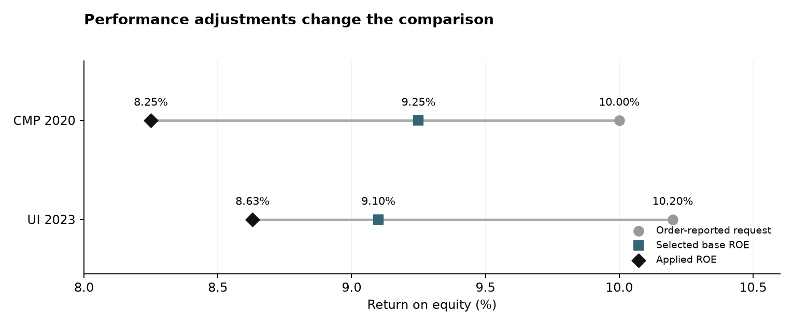
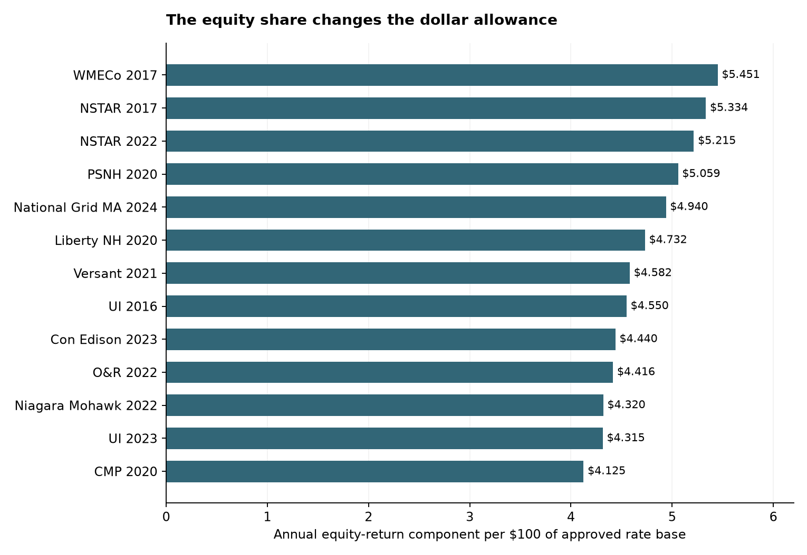

# What changes when rate cases are compared more closely?

Kazi Rafsan Mahboob | October 31, 2026 | Original-order development pilot

A published return on equity combines several decisions. The commission chooses a financing allowance, may adjust it for performance, and decides how much of the utility's investment is financed with equity. Reading those decisions together changes the comparison between cases.

The 15-proceeding pilot now has original decisions for every selected proceeding. It establishes three concrete results: performance reductions explain a substantial part of two request-to-award gaps; the same ROE can produce different equity allowances; and a small change in ROE can have a material annual dollar value on a large regulated asset base.

## Performance explains part of the request-to-award difference

Central Maine Power requested 10.00%. The commission selected a 9.25% base return and imposed a separate 100-basis-point management reduction, producing an applied return of 8.25%. The performance reduction accounts for **57% of the 175-basis-point gap** between the request and applied return. The commission separately stated that the reduction lowered the annual revenue requirement by $6.6 million. See the [original proceeding](https://mpuc-cms.maine.gov/CQM.Public.WebUI/Common/CaseMaster.aspx?CaseNumber=2018-00194), printed decision pages 74, 85, 118 and 137.

United Illuminating's 2023 decision provides a second example. Its order-reported request was 10.20%, its selected base return was 9.10%, and the cumulative management and performance reduction was 47 basis points. The resulting 8.63% applied return is 157 basis points below the request. The explicit reduction accounts for **30% of that gap**. The [decision](https://www.dpuc.state.ct.us/dockcurr.nsf/8e6fc37a54110e3e852576190052b64d/dd7c1a0c81056b1485258a16004f1d22/$FILE/220808-082523.pdf) reports the request on printed page 3, the financial schedule on page 59 and the base-return and adjustment discussion on page 91.



This distinction improves the explanation of the earlier Maine prediction error. A model of financing conditions is being compared with an outcome that includes a substantial service-performance judgment. The historical prediction target remains the applied award; the source review explains its composition.

## The equity share matters as well as the return

Rate base is the regulated investment on which the utility is allowed to earn a return. The approved equity share determines how much of that base receives the equity allowance. For a $100 rate base, the annual equity component is:

**$100 × approved equity share × applied ROE.**

The joint 2017 Massachusetts decision gives a useful comparison within one proceeding. NSTAR and Western Massachusetts Electric both received 10.00% ROEs. Their approved equity shares were 53.34% and 54.51%. The resulting annual equity components were **$5.334 and $5.451 per $100 of rate base**, respectively. WMECo's component was 2.2% higher despite the identical headline return. The [original order](https://www.mass.gov/files/documents/2018/01/26/17-05_Final_Order_Revenue_Requirement_11-30-17.pdf), printed pages 770 and 779, supplies the adopted capital schedules.



The exhibit covers 13 schedules from 12 proceedings. Each label identifies the decision year; these are individual schedules across different years, rather than a ranking of commissions' generosity or utilities' investment risk.

## Translate the difference into dollars

For Massachusetts Electric and Nantucket Electric's combined 2024 schedule, the approved distribution rate base was **$3,126,561,965** and the equity share was **52.83%**. Holding those inputs fixed gives the following annual sensitivity:

| ROE change | Change in annual equity component |
|---|---:|
| 10 basis points | $1.65 million |
| 25 basis points | $4.13 million |
| 50 basis points | $8.26 million |

The calculation for 25 basis points is $3,126,561,965 × 0.5283 × 0.0025. The approved inputs are on printed pages 647 and 648 of D.P.U. 23-150; the [source register](../../data/research/comparability-v1/phase2/sources.json) identifies the commission's original file and locating page. The [full sensitivity table](financial_sensitivity.csv) applies the same calculation to nine schedules with approved rate-base inputs.

Grid expansion adds assets that must be financed and paid for. The return and capital mix determine part of the annual financing allowance. The calculation above puts the scale of a return difference in dollars while keeping the approved investment base and equity share fixed.

## Coverage and request audit

The frozen pilot contains **15 proceedings in six states**. Their original dispositions produce 16 financial schedules because the joint 2017 Massachusetts case has separate NSTAR and WMECo schedules. The other joint orders retain their identified electric or combined electric schedule. Related order parts stay within the same proceeding.

| Item | Coverage |
|---|---:|
| Proceedings with original dispositions obtained | 15 of 15 |
| Proceedings with applied ROE and approved equity share | 12 of 15 |
| Financial schedules with those two inputs | 13 of 16 |
| Schedules with an approved rate-base amount entered | 9 of 16 |
| Proceedings with a separately quantified base/adjustment pair entered | 2 of 15 |
| Proceedings with a numeric utility ROE position established from the order | 12 of 15 |

The three Pennsylvania decisions approve negotiated revenue packages without individually adopting the base-rate return components. They stay in the dataset with explicit missing values. Rider-specific returns and plant thresholds are kept separate from base-rate ROEs and approved rate bases.

The request review also identifies a choice hidden by a single request column. Niagara Mohawk's filing offered **9.50% for a one-year plan and 10.00% for a multi-year alternative**. These are alternatives in the same filing, rather than evidence of a later upward revision. The order discusses both on printed page 68. The 9.50% position is used in the main pilot table, with the alternative retained in the request register.

Two chronology distinctions are recorded. Versant's Part I financial decision is dated October 18, 2021; Part II supplies its reasoning on October 28. PECO's adopted recommended decision reports a March 30, 2021 filing. These original-document dates are retained separately from the historical publisher's entries. The private publisher reconciliation does not alter or redistribute the national case table.

## Files and reproduction

- [Pilot financial table](pilot_financials.csv): decimal rates, approved inputs and calculated equity components.
- [Calculated results and evidence links](pilot_results.json): schedule-level values, source locations and performance bridges.
- [Source records](../../data/research/comparability-v1/phase2/sources.json), [facts](../../data/research/comparability-v1/phase2/facts.json), [requests](../../data/research/comparability-v1/phase2/requests.json) and [proceedings](../../data/research/comparability-v1/phase2/proceedings.json).
- [Dated study design](../../docs/comparability_plan_2026-10-31.md), [field definitions](../../docs/comparability_fields.md) and [fixed selection record](../../data/research/comparability-v1/pilot.json).

From an installed repository environment:

```sh
python -m scripts.analyze_comparability
python -m pytest -q tests/test_rate_case_comparisons.py
Rscript analysis/comparability_check.R
```

These calculations use the original-order fact records included here. They do not require the EEI workbook. Python rebuilds both figures, the CSV tables and the results JSON. The native R script checks the financial arithmetic; it has been run. Source PDFs and DOCX files are cached in the separate local archive, with metadata and source links included in this package.

## Interpretation and next steps

This is a purposive measurement pilot, developed after the historical results were known. Source coverage, rather than the number of PDFs, determines which calculations are available. The original application files have not been inspected for all request entries. The request register distinguishes an order's account of an initial filing from a company schedule or later position. It therefore supports reconciliation of reported positions, while a filing-day vintage audit still requires the original dated submissions.

The financial calculation is an equity-return component, not a complete revenue requirement or customer bill change. Debt costs, income-tax treatment, depreciation, operating costs, other revenues and class allocations matter for those broader questions. The first-year UI 2016 rate base is reported in rounded millions. Source rounding also affects capital shares. No separately quantified adjustment is entered where the order does not establish a base/adjustment pair; missing entries are not treated as zero.

Original dispositions and the first financial extraction are complete for the selected pilot. Pre-existing mechanism classifications and a full initial-submission audit still need further filing review. The fixed comparator rules have not yet been evaluated, a new prediction model has not been estimated, and independent human passage agreement remains unmeasured. The next analytical stage compares the pre-filing reference groups and completes the separately ranked diagnostic reading. The national estimates and existing paper remain unchanged.
