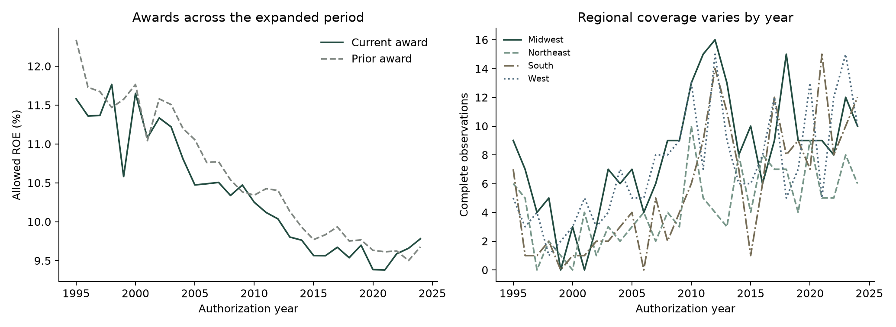
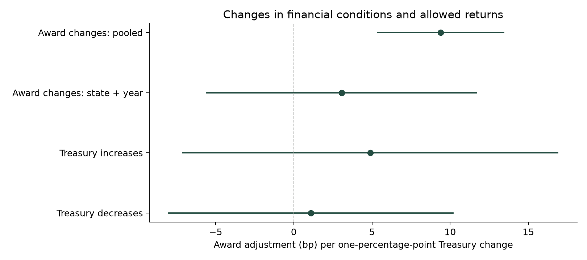
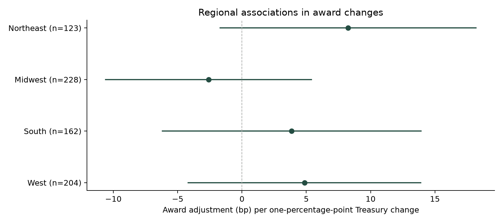
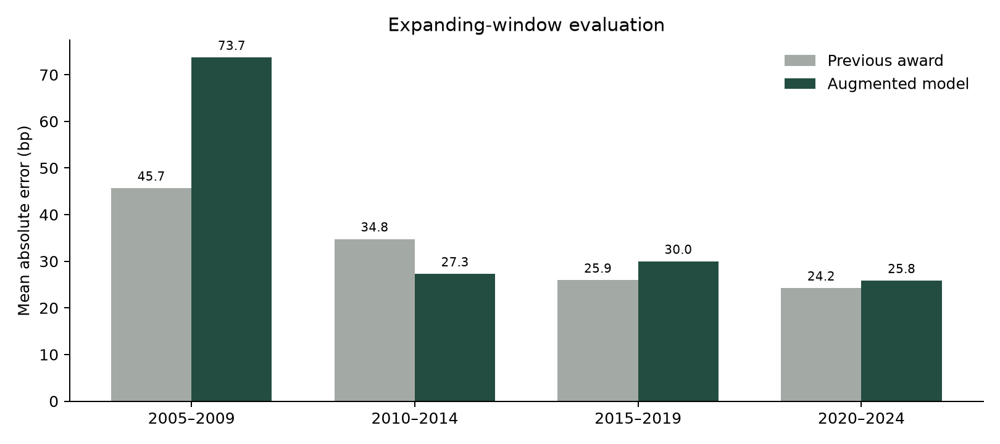

# Historical Persistence and Regional Adjustment in Authorized Utility Returns

Kazi Rafsan Mahboob · October 28, 2026

I extend the numerical study to 1995–2024 and ask whether persistence in utility returns survives a longer history, local economic controls and repeated prediction tests. The main sample increases from 533 to **759 complete observations**, a **42.4% increase**. It covers 48 jurisdictions, 147 utility-state labels and 117 authorization quarters. A separate 1985–2024 specification uses **1,141 observations** without financial stress, whose source history starts later.

The earlier study remains unchanged. Its 533 case IDs are all preserved in the common-period portion of the extension. The larger sample comes from additional historical EEI observations and longer economic histories. These are publisher-table entries, rather than newly coded original-order PDFs.

## Persistence remains after utility and year controls

A one-percentage-point higher prior award is associated with a **21.63-basis-point** higher current award after utility-state and year controls. Its approximate 95% interval is **7.10 to 36.16 basis points**. The larger window therefore supports a positive within-utility association that was imprecise in the original 15-year sample.

| Controls in the 759-observation sample | Prior-award association, bp per one percentage point | Approximate 95% interval |
|---|---:|---:|
| Market, case and local conditions | 51.82 | 38.45 to 65.19 |
| Add state and year effects | 24.01 | 12.50 to 35.53 |
| Utility-state and year effects | 21.63 | 7.10 to 36.16 |

Removing each of the 48 jurisdictions in turn from the state/year specification gives prior-award coefficients from **19.10 to 26.02 basis points**. Every corresponding interval remains positive. This diagnostic uses state/year controls; it is not a separate omission check of the utility-state specification. The full [state-omission table](state_influence.csv) preserves every result.

The association is consistent with continuity in the factors that determine allowed returns. Earlier awards can reflect persistent company risk, commission practice and the financial assumptions carried between proceedings. The regressions do not separate those explanations.

## The interest-rate association depends on the period

I compare specifications with the same predictor list, excluding financial stress in both windows. The Treasury coefficient is small and imprecise in 1995–2024, but positive when the earlier decade is added.

| Window, with state and year effects | Observations | Treasury association, bp per one percentage point | Approximate 95% interval |
|---|---:|---:|---:|
| 1995–2024, without stress | 759 | -2.28 | -7.32 to 2.77 |
| 1985–2024, without stress | 1,141 | 13.31 | 6.30 to 20.33 |

This is evidence against treating one pooled interest-rate coefficient as a stable regulatory response. The windows contain different decisions and economic environments. State/year effects absorb common annual changes, leaving identification from remaining differences in timing and case conditions.

The change models provide a second comparison. Across 717 matched award-change observations, a one-percentage-point Treasury change is associated with **9.39 basis points** of award adjustment in the pooled specification. With state and year effects, the estimate falls to **3.06 basis points**, with an interval of **-5.56 to 11.68**. The rise-versus-fall test does not distinguish the two slopes in this specification, with p = 0.556.

## Regional differences warrant a closer investigation

The regional interaction model finds differences among the four Census regions' Treasury-change slopes after the other change variables, state effects and year effects are included. The joint test is sensitive to the covariance choice, although each of the three reported versions rejects equal slopes at the 5% level.

| Covariance calculation | Approximate joint-test p-value |
|---|---:|
| State and authorization quarter | 0.0000000039 |
| State only | 0.00145 |
| Authorization quarter only | 0.02772 |

The estimated slopes themselves remain imprecise. The point estimates are 8.25 basis points in the Northeast, -2.60 in the Midwest, 3.87 in the South and 4.86 in the West per one-percentage-point Treasury change. Every individual slope interval includes zero. The [regional slope table](regional_slopes.csv) reports those intervals and the supporting case counts.

In the state-omission diagnostic, 47 regional joint tests have usable two-way restriction covariance. Their p-values range up to 0.0343. Omitting Michigan produces an indefinite restriction covariance, so that test is recorded as unavailable. State-only and quarter-only calculations are retained separately in the omission table. Quarter-only p-values reach 0.148 across those omissions, so the regional result is less stable than the prior-award association. I interpret it as a reason to investigate institutional differences, rather than as a ranking of commissions or a causal regional effect.

Local unemployment adds another observable factor, but its coefficient is close to zero after utility-state and year effects. A new data source does not automatically provide a useful predictor.

## A simple prediction rule remains competitive

The four available expanding-window evaluations contain **634 unique later-case predictions**. Their fitted coefficients use only earlier training years. The 2000–2004 block is retained as unavailable because its training sample has only 65 observations, below the planned minimum of 100.

| Evaluation block | Observations | Previous-award MAE, bp | Augmented-model MAE, bp |
|---|---:|---:|---:|
| 2005–2009 | 101 | 45.66 | 73.69 |
| 2010–2014 | 192 | 34.76 | 27.27 |
| 2015–2019 | 153 | 25.92 | 29.96 |
| 2020–2024 | 188 | 24.24 | 25.83 |
| All available blocks | 634 | **31.24** | **34.89** |

Adding prior awards improves on the market-and-case model by **16.89 basis points**, with a conditional approximate interval of **12.11 to 21.67**. The fuller model nevertheless loses to the previous-award rule on aggregate. Its paired improvement is **-3.64 basis points**, with an interval of **-9.89 to 2.60**. Extra variables and a longer training history do not consistently improve predictions over the simple rule.

The original single-holdout result remains available in the [earlier evaluation](../prediction-audit/README.md). It uses a different training window. Reporting both results makes the dependence on that choice visible.

## What the extension adds

The evidence for persistence is stronger across the longer panel, including after utility-state controls. The interest-rate relationship varies with the historical window and model. Regional differences appear in the conditional change specification, but their magnitude and uncertainty require care. Repeated prediction tests favor the previous award as the practical baseline.

Authorized ROE is an allowed earnings opportunity, not a realized investor return. The models use revised historical predictors and do not estimate a causal effect of precedent. Original passage coding is a separate component and does not enter these numerical results.

## Data, code and checks

- [Study JSON](study.json), [coefficients](coefficients.csv) and [model coverage](model_coverage.csv).
- [Complete panel and inclusion flags](panel.csv), [main estimation CSV](estimation.csv), [change panel](changes.csv) and [longer-window panel](long.csv).
- [Stata main dataset](estimation.dta), [change dataset](changes.dta), [longer dataset](long.dta) and [full panel](panel.dta).
- [Predictions](predictions.csv), [region counts](regions.csv), [annual counts](annual.csv) and [specifications](model_specs.csv).
- [Covariance sensitivity](covariance_sensitivity.csv), [joint tests](joint_test_sensitivity.csv), [regional slopes](regional_slopes.csv) and [state omissions](state_influence.csv).
- [R coefficient check](r-crosscheck.csv), [R prediction check](r-predictions.csv), [R covariance check](r-covariance.csv), [R joint tests](r-joint-tests.csv), [R slopes](r-regional-slopes.csv) and [R figure](r-history.png).
- [Join benchmark](join-benchmark.json) and [artifact fingerprints](manifest.json).

Base R independently reconstructs all 15 model designs and the rolling predictions. NumPy coefficients and covariance are also tested against statsmodels. The Stata datasets preserve their source IDs and numeric values on round-trip checks; native Stata execution remains unverified.

The [methods and commands](../../docs/expanded_study.md), [source guide](../../docs/expanded_sources.md) and [analysis plan](../../docs/expanded_analysis_plan_2026-10-28.md) provide the definitions needed to reproduce or extend the work.
