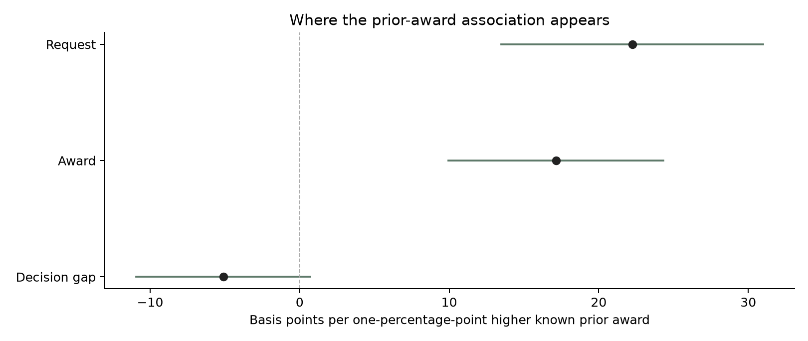
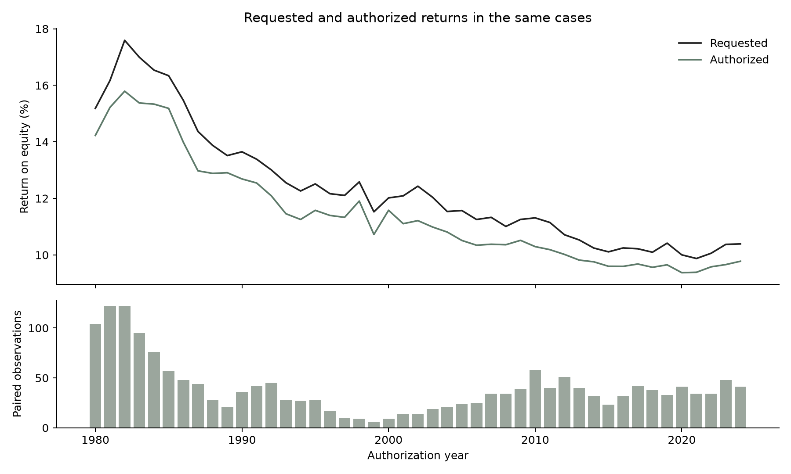

# Requests, Decisions and Persistence in Utility Returns

Kazi Rafsan Mahboob · October 30, 2026

My earlier models showed that a utility's previous allowed return predicts its next award. That result left an important question open: how much of this persistence is already present when the utility makes its request?

I compare **1,785 recorded request-and-award pairs from 1980–2024**. The main stage analysis uses **1,266 observations from 1985–2024**, with **1,135** in the common sample requiring an award known before filing. I then compare six prediction rules on **568 later cases**, using training decisions dated before each evaluation block.

## Persistence is already visible in the request

On the common 1,135-observation sample, a one-percentage-point higher prior award is associated with a **22.24-basis-point** higher request after state and year effects and the financial and case controls. The corresponding association with the final award is **17.13 basis points**.

| Outcome, same sample and controls | Prior-award association, bp per one percentage point | Approximate 95% interval |
|---|---:|---:|
| Requested return | 22.24 | 13.49 to 31.00 |
| Authorized return | 17.13 | 9.93 to 24.34 |
| Authorized minus requested return | -5.11 | -10.93 to 0.72 |

The coefficients add exactly: 22.24 plus -5.11 equals 17.13 before rounding. The association with the earlier award therefore appears in the request as well as the final decision. The negative gap coefficient is not precise enough to establish that commissions systematically offset that association.

Replacing state effects with utility-state effects gives a prior-award association of **14.69 basis points** for the final award, with an interval of **6.65 to 22.72**. Giving each state/decision date equal total weight gives **17.10 basis points** under state/year effects. Removing each jurisdiction in turn gives estimates from **15.32 to 18.33**, with every corresponding interval above zero.

These checks strengthen the evidence for continuity in the recorded returns. They do not distinguish stable utility risk, investment needs, commission practice or expectations about the likely decision. The request is an endogenous choice. The decomposition is an accounting identity applied to regressions, not a causal explanation of bargaining.

## Separating rates at filing from changes during the case

The stage design distinguishes the financial conditions near filing from changes before authorization. In the known-prior model with state/year effects, both Treasury terms have positive associations with the final award.

| Treasury variable | Award association, bp per one percentage point | Approximate 95% interval |
|---|---:|---:|
| Prior 90-day mean at filing | 21.20 | 12.67 to 29.73 |
| Decision-window mean minus filing-window mean | 9.94 | 2.98 to 16.89 |

This timing distinction contains information that a single decision-date yield cannot describe. The change variable is an observed difference during the case, not an identified unexpected shock. These coefficients come from the 1985–2024 paired sample and should not be substituted for estimates from the earlier 1995–2024 model. Inflation and unemployment intervals include zero in this specification; their inclusion does not by itself establish an additional explanatory relationship.

## The request improves the combined model

The model using financial conditions and the known prior award has **33.58 basis points** of average absolute error. Adding the request reduces that to **26.79**. Simply carrying forward the known prior gives **31.82**.

| Prediction rule | Mean absolute error, bp |
|---|---:|
| Known prior award | 31.82 |
| Recorded request | 66.01 |
| Request + historical average gap | 42.57 |
| Prior + historical average change | 65.61 |
| Market/prior model | 33.58 |
| Model with request | **26.79** |

The combined model improves on the prior-award rule by **5.03 basis points**, about **15.8%**. The paired conditional 95% interval for that improvement is **0.62 to 9.45 basis points**. Its improvement over the market/prior model is **6.79 basis points**, with an interval of **3.03 to 10.55**.

The request is useful in combination with other information. Taking it at face value, or subtracting one average historical gap, performs substantially worse. Requested returns are usually higher than final awards, and a constant adjustment does not adequately capture changes across the sample.

The improvement is not confined to exact request/award matches. After excluding those 77 cases, the saved predictions improve on the prior by **7.08 basis points** across **491 cases**, with an interval of **2.11 to 12.04**. This conditions on an observed outcome and is a diagnostic, not a rule for selecting future cases.

Omitting each state from the saved prediction comparison leaves a positive point improvement between **4.45 and 5.88 basis points**. The interval includes zero when Illinois is omitted: **4.52**, with an interval of **-0.24 to 9.28**. The direction is stable across those omissions, while the statistical precision is less uniform. These checks reuse fixed predictions and do not refit the training models.

## The gain does not hold in every period

| Filing-year block | Cases | Known-prior MAE, bp | Model-with-request MAE, bp |
|---|---:|---:|---:|
| 2005–2009 | 122 | 41.16 | 35.08 |
| 2010–2014 | 169 | 35.38 | 27.63 |
| 2015–2019 | 175 | 27.65 | 21.57 |
| 2020–2022 | 102 | **21.93** | 24.43 |

The combined model improves on the prior in the first three available blocks and loses in the most recent one. In 2005–2009, the market/prior model also performs slightly better than the model with the request. This makes the aggregate improvement useful evidence, but not a reason to assume one model will dominate in a new interest-rate environment.

The planned 2000–2004 block remains unavailable because its training design has no variation in distribution status. The output preserves that block and its reason rather than removing a predictor after seeing the problem.

## A larger historical comparison

Across the 1,785 pairs, the final award is below the recorded request in **1,562 cases**, equal in **190**, and above it in **33**. Award minus request averages **-97.68 basis points**, with a median of **-83.00**. These are differences within the same cases, not differences between separate request and award samples.

The table does not include every U.S. utility proceeding. Original-document coding remains a separate project component. These are publisher observations, and the larger pair count should not be described as 1,785 independently reviewed commission orders.

## What I take from the results

An earlier award is informative before the next decision, and that association is already visible in the recorded request. The request adds predictive information when combined with financial conditions and the earlier award. The most recent evaluation block nevertheless favors the simple prior-award rule.

This changes the investigation from a single correlation between rates and returns to a comparison of recorded stages and prediction rules. A closer examination of original filings could test whether investment plans, risk arguments or regulatory mechanisms account for the additional information in requests. The current numbers do not establish those explanations.

The comparison uses revised economic histories and EEI's recorded request values. The workbook does not preserve amendment histories, so it cannot verify that each request value was available on the exact filing date. Chronology is enforced for prior awards and economic reference windows. Results are retrospective, conditional on completed cases and fitted models, rather than a live-issued forecast record.

## Data and reproduction

- [Complete candidate panel](panel.csv), [all paired cases](paired.csv), [stage sample](stage.csv) and [known-prior sample](known-prior.csv).
- [Coefficients and covariance sensitivity](coefficients.csv), [model definitions](model_specs.csv), [sample coverage](models.csv) and [coefficient decomposition](decomposition.csv).
- [Predictions](predictions.csv), [annual pairs](annual.csv), [regional pairs](regional.csv) and [state omissions](state_omission.csv).
- [Prediction selection check](prediction_sensitivity.csv), [prediction state omissions](prediction_state_omission.csv) and their [R](r-prediction-sensitivity.csv) [checks](r-prediction-omission.csv).
- [Study JSON](study.json), [browser records](cases.json), [Stata paired data](paired.dta), [Stata stage data](stage.dta) and [Stata prior data](known-prior.dta).
- [R coefficient checks](r-coefficients.csv), [R decomposition](r-decomposition.csv), [R predictions](r-predictions.csv) and [file fingerprints](manifest.json).

Read the [methods](../../docs/filing_study.md) and [dated plan](../../docs/filing_analysis_plan_2026-10-30.md). Run `make filing` to rebuild and cross-check in native R. The earlier [historical expansion](../expanded-study/README.md) and [original prediction audit](../prediction-audit/README.md) remain unchanged. Native Stata execution remains unverified.
