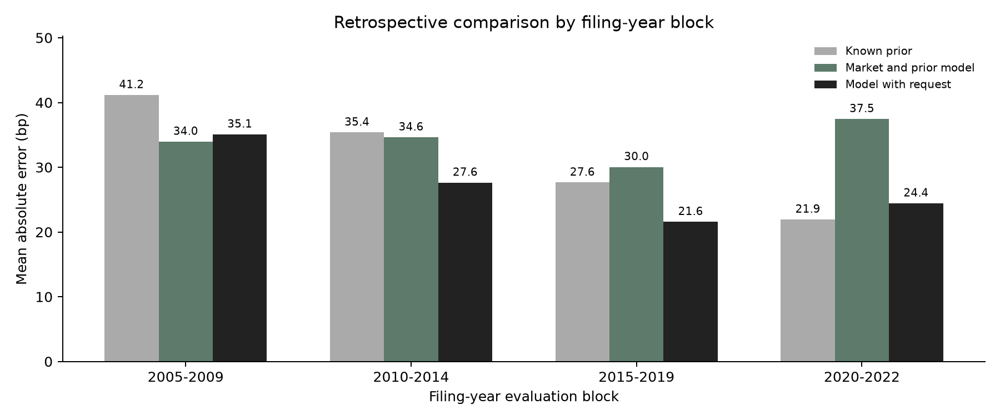

# Requests, awards and prediction

A utility's requested return adds information to its previous award and financing conditions. Across 568 later cases, it reduces average prediction error from 33.58 to 26.79 basis points. The comparison across filing periods also shows when the simpler prior-award rule works better.

The [working paper](../../paper/manuscript.md) explains the economic question and interpretation. This folder contains the underlying aggregate results.

## Requests and decisions

| Sample | Observations |
|---|---:|
| Request-and-award pairs, 1980-2024 | 1,785 |
| Complete stage regressions, 1985-2024 | 1,266 |
| Common sample with an award known before filing | 1,135 |
| Later-case prediction comparisons | 568 |

On the common sample, a one-percentage-point higher prior award is associated with a **22.24-basis-point higher request** and a **17.13-basis-point higher final award**, after the stated controls. Continuity appears in the utility's position as well as the eventual decision. The coefficient on award minus request is -5.11 basis points, with an interval spanning zero.

## Prediction across periods

Average absolute error measures the distance between predicted and actual awards. Lower values indicate better predictions.

| Filing years | Cases | Prior only, bp | Market and prior, bp | Add request, bp |
|---|---:|---:|---:|---:|
| 2005-2009 | 122 | 41.16 | 33.95 | 35.08 |
| 2010-2014 | 169 | 35.38 | 34.63 | 27.63 |
| 2015-2019 | 175 | 27.65 | 30.04 | 21.57 |
| 2020-2022 | 102 | 21.93 | 37.45 | 24.43 |
| All evaluated cases | 568 | 31.82 | 33.58 | 26.79 |

Adding the request improves on the prior-only rule by **5.03 basis points**, about 16%, with an approximate conditional 95% interval of 0.62 to 9.45. In the recent group, carrying the prior forward is more accurate than either estimated model. That result gives a specific reason to examine continuity and case-level adjustments more closely. The [original-order review](../comparability/README.md) provides the first financial comparisons.

## Tables and reproduction

[Study results](study.json) · [Coefficients](coefficients.csv) · [Model definitions](model_specs.csv) · [Sample coverage](models.csv) · [Stage comparison](decomposition.csv)

The [reproduction guide](../../docs/REPRODUCIBILITY.md) provides the national build command. Case panels and prediction rows are local outputs generated from the acquired workbook. [Methods](../../docs/filing_study.md) document timing, controls and uncertainty; the [dated plan](../../docs/filing_analysis_plan_2026-10-30.md) records the empirical rules and subsequent diagnostics.

## Interpretation

These are retrospective predictions using recorded requests and revised economic histories. The recent filing group includes decisions from 2020 through 2024; the [peer report](../peer-study/README.md) records the decision-timing split. The reported gain interval conditions on the fitted models. Stage coefficients use a shared linear design, so their additive relationship is an accounting property of that design. Native R checks have been run; Stata specifications are provided separately.
