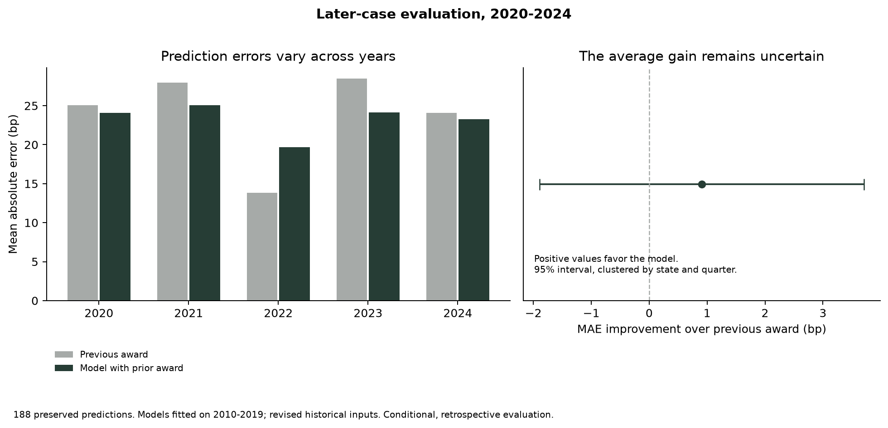

# Prediction evaluation

Kazi Rafsan Mahboob · October 28, 2026

I evaluate the 188 saved predictions for decisions in 2020-2024. The models were fitted on 2010-2019 data. This extension measures error, uncertainty and stability without refitting the models or choosing a favorable evaluation sample.

## What the comparison shows

Adding the previous award to the market-and-case model reduces mean absolute error by **29.78 basis points**, or **56.1%**. The approximate 95% interval for that paired improvement is **22.06 to 37.50 basis points**. The augmented model has smaller absolute error in 156 of 188 observations.

The harder comparison is the previous-award rule itself. The augmented model improves mean absolute error by **0.91 basis points**, with an approximate 95% interval of **-1.89 to 3.71**. It has smaller error in 86 observations and larger error in 102. A positive average gain despite more individual losses reflects the sizes of the errors, rather than a higher case-level win rate.

| Reference for the augmented model | MAE improvement, bp | Approximate 95% interval | Observations with smaller error |
|---|---:|---:|---:|
| Previous-award rule | 0.91 | -1.89 to 3.71 | 86 / 188 |
| Market-and-case model | 29.78 | 22.06 to 37.50 | 156 / 188 |

Intervals use state and authorization-quarter clusters: 42 states and 20 quarters. They condition on the already fitted models and exclude training-estimation and data-revision uncertainty. The [method note](../../docs/prediction_evaluation.md) explains these limits and the covariance calculation.



## Annual stability

| Year | Observations | Previous-award MAE, bp | Augmented-model MAE, bp | Improvement, bp |
|---|---:|---:|---:|---:|
| 2020 | 38 | 25.08 | 24.10 | 0.97 |
| 2021 | 34 | 27.97 | 25.05 | 2.92 |
| 2022 | 33 | 13.82 | 19.67 | -5.85 |
| 2023 | 45 | 28.47 | 24.11 | 4.35 |
| 2024 | 38 | 24.11 | 23.27 | 0.84 |

The augmented model improves average error in four of the five years. It performs worse in 2022, when the previous-award rule has a 13.82-basis-point MAE compared with 19.67 for the augmented model. Its mean signed error also changes from overprediction in 2020-2022 to underprediction in 2023-2024. These patterns show that the aggregate gain is not uniform. The annual comparison does not identify the cause of the shift.

## Weighting and case mix

Giving each of the 105 utility-state groups equal weight produces a **1.58-basis-point** improvement over the previous-award rule. Omitting each state in turn gives row-weighted improvements from **0.42 to 1.63 basis points**. No single state reverses the point estimate, but these are influence checks rather than additional confidence intervals.

The observed improvement is **2.51 basis points** in the 53 distribution observations and **0.28 basis points** in the 135 vertically integrated observations. These are descriptive subgroup differences. Case mix and within-group dependence prevent treating them as a confirmed difference in regulatory behavior.

## Interpretation

Earlier awards are useful for prediction. Once that information is included, the extra accuracy provided by the other fitted variables is small and uncertain in this evaluation. A simple baseline is therefore essential when assessing the model. This result does not establish that regulators mechanically follow precedent: persistent risk, commission policy and formula design remain possible explanations for the persistence.

The evaluation is retrospective and uses revised economic histories. The study cannot be presented as a live forecast issued before the evaluation period. Original passage coding is a separate research component and does not enter these calculations.

## Files and reproduction

- [summary.json](summary.json): coverage, metrics, paired intervals and weighting checks.
- [paired_predictions.csv](paired_predictions.csv): the same 188 source-linked observations, predictions and losses.
- [annual.csv](annual.csv) and [case_types.csv](case_types.csv): all four prediction rules with their denominators.
- [leave_one_state_out.csv](leave_one_state_out.csv): the complete influence check.
- [python_checks.csv](python_checks.csv) and [r-crosscheck.csv](r-crosscheck.csv): 12 numerical comparisons.
- [Native R figure](r-prediction-errors.png) and [manifest.json](manifest.json): replication output and file fingerprints.

```sh
python -m src.prediction_audit
Rscript analysis/prediction_audit.R reports/prediction-audit
python -m src.prediction_audit --verify-r
python -m src.prediction_audit --check
```

The saved release passed all 12 native R comparisons within 1e-8. The original [factor-study outputs](../factor-study/) are unchanged.
